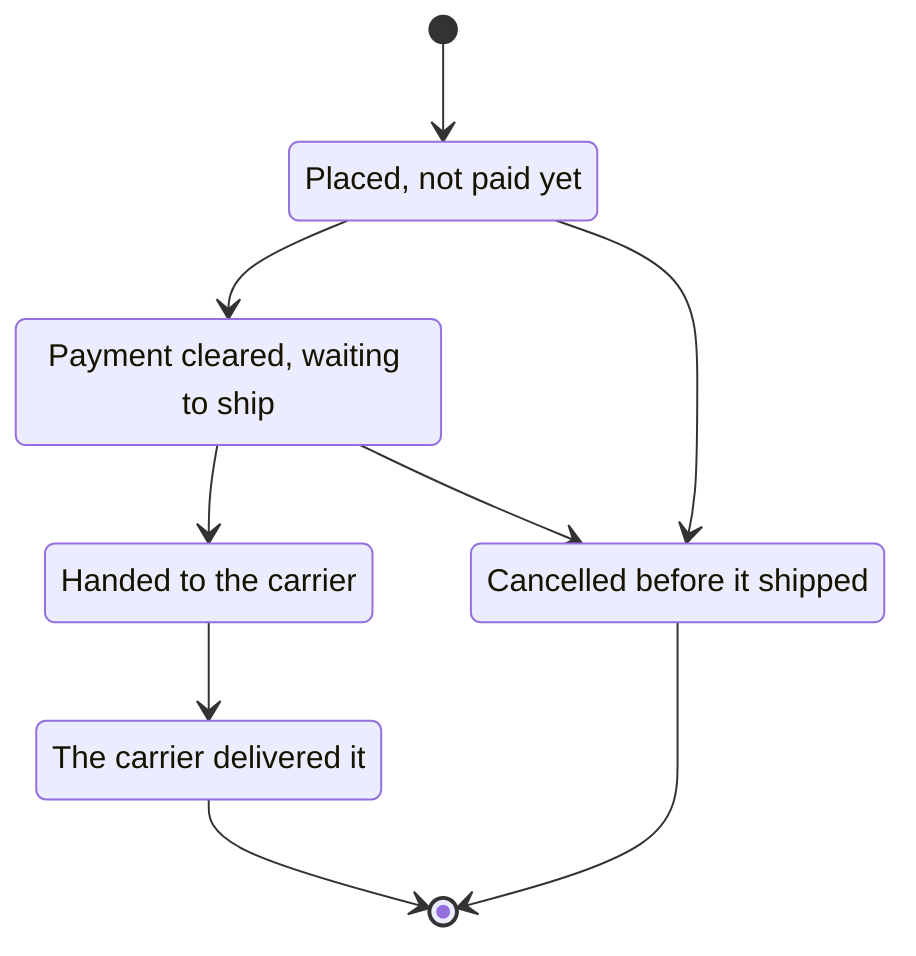

# AgenticFSM

State machines for things that take days: orders, tickets, applications. You declare the states
an entity can be in and the moves allowed between them. Each state has one **handler**, the code
(or the model) that decides where the entity goes next. The library checks every move against
your list and logs it.

```bash
pip install agentic-fsm
```

## Why

An order is placed today, paid tomorrow and shipped next week. In between it sits in a database
row. The rules for moving it on usually end up spread over a webhook, a cron job and an admin
action, each writing to a `status` column. Nothing says which moves are allowed, and nothing
records who made the last one.

AgenticFSM puts all of it in one declaration:

- **Each state has one handler.** It looks at the entity and returns the next state, or `None`
  to leave it where it is for now.
- **One list of edges** says which moves exist. A handler that returns anything else has a bug:
  the move is refused and nothing is written.
- **Every move is a row in a log**: from, to, when, and who decided (`code`, `llm:<model>` or
  `agent`).
- **A model can be a handler.** It is offered only the states the edges allow, each with its
  description, and its answer is logged with the move. A coding agent or a person can answer
  instead of the model, with no API key.

The library keeps the state and the log. Your entity stays in your own tables.

Here is the machine used throughout this page, drawn by `agfsm show --mermaid`:



## Quick start

A complete, runnable machine, with its state kept in memory:

```python
from dataclasses import dataclass
from agentic_fsm import Machine, States, InitialState, State, FinalState

@dataclass
class OrderRow:
    paid: bool = False
    tracking_number: str | None = None

ORDERS = {"42": OrderRow()}            # your own table; ids reach you as strings (see below)


# A handler reads the entity and returns the next state, or None to leave it for now.
# (They name `Order`, declared just below; that's fine, since they run later.)
def await_payment(order):
    return Order.paid if order.paid else None

def pack(order):
    return Order.shipped if order.tracking_number else None


# States are declared like Django model fields: a description, and the state's handler.
class Order(States):
    pending = InitialState("Placed, not paid yet", handler=await_payment)
    paid    = State("Payment cleared, waiting to ship", handler=pack)
    shipped = FinalState("Handed to the carrier")


orders = Machine(
    Order,
    [(Order.pending, Order.paid), (Order.paid, Order.shipped)],   # the allowed moves
    load=ORDERS.get,                                              # id -> your entity
    backend="agentic_fsm.backends.locmem",                        # where state is kept
)

orders.start(42)
orders.fire(42)                        # None: not paid, so it stays in pending

ORDERS["42"].paid = True
orders.fire(42)                        # Move(from_state='pending', to_state='paid', decided_by='code', ...)

ORDERS["42"].tracking_number = "1Z999"
orders.progress(42)                    # keeps moving it until no handler moves it further
orders.state_of(42)                    # Order.shipped
orders.history(42)                     # start, pending -> paid, paid -> shipped
```

In production, swap `locmem` for the Django or SQLAlchemy backend (see
[State backends](#state-backends)) and call `orders.progress_all()` from a scheduler.

## The pieces

| Piece | What it is |
|---|---|
| **Entity** | One thing moving through the machine: an order, a ticket. It lives in your tables; the machine knows it by id |
| **State** | A member of a `States` class. Its description is its definition, and it names its handler. Exactly one `InitialState`; a `FinalState` has no handler and nothing leaves it |
| **Handler** | A function of the entity (or a `Handler` object, such as a `Decide`). Returns the next state, `None` to leave the entity for now, or another handler to pass the decision to |
| **Edges** | A list of `(from, to)` pairs. A handler may only return the states its state has an edge to |
| **Machine** | `Machine(States, edges, load=, backend=)`. Checks the declaration, then starts and moves entities |
| **Move** | One log row: `from_state`, `to_state`, `decided_by`, `at`, and the model's `decision` if one decided |
| **Backend** | Where state and the log are kept: in memory, a Django project's database, or any database SQLAlchemy reaches |

`load(id)` fetches the entity from your own tables. Ids are stored as text, so `load` always
receives a string, even when you called `start(42)`.

A machine's name is the `States` class name in lower case (`order`), or `Machine(..., name=)`.
The log and the command line use it: entity 42 of this machine is `order:42`.

## Declaring a machine

A handler is ordinary Python, so it can test several things in turn. Here an order can be
cancelled while it waits for payment or for packing, and the cancellation is checked first:

```python
def await_payment(order):
    if order.cancel_requested:
        return Order.cancelled
    return Order.paid if order.payment.cleared else None

def pack(order):
    if order.cancel_requested:
        return Order.cancelled
    return Order.shipped if order.tracking_number else None

def await_delivery(order):
    return Order.delivered if order.carrier_status == "delivered" else None


class Order(States):
    pending   = InitialState("Placed, not paid yet", handler=await_payment)
    paid      = State("Payment cleared, waiting to ship", handler=pack)
    shipped   = State("Handed to the carrier", handler=await_delivery)
    delivered = FinalState("The carrier delivered it")
    cancelled = FinalState("Cancelled before it shipped")


EDGES = [
    (Order.pending, Order.paid),
    (Order.pending, Order.cancelled),
    (Order.paid,    Order.shipped),
    (Order.paid,    Order.cancelled),
    (Order.shipped, Order.delivered),
]

orders = Machine(Order, EDGES, load=get_order, backend="agentic_fsm.backends.django")
```

An edge's `from` may be a tuple, as shorthand for one edge from each:
`((Order.pending, Order.paid), Order.cancelled)`.

`Order` is a real `str` enum (`Order.paid == "paid"`), so it can be used as a Pydantic type or a
database value.

`Machine(...)` refuses a declaration that can't work, with a `MachineError` naming the state or
edge:

- not exactly one `InitialState`;
- a state that can't be reached from the initial one;
- a state that isn't final but has no handler, or no edge out;
- a `FinalState` with a handler, or an edge leaving it;
- an edge to a state of another machine.

## Moving entities

There are three ways to move an entity:

- **`fire(id)`** runs the handler of the entity's current state once: at most one move.
- **`progress(id)`** fires one entity again and again until it stops moving.
- **`progress_all()`** fires every unfinished entity once: at most one move each. This is the
  call a scheduler makes.

| Call | Does |
|---|---|
| `orders.start(42)` | puts an entity in the initial state (`AlreadyStarted` if it has a state) |
| `orders.start_all(order_ids)` | starts each of the ids that has no state yet |
| `orders.fire(42)` | runs the handler of the entity's state; returns the `Move`, or `None` if it stays |
| `orders.fire(42, entity=order)` | the same, on the order already in hand instead of `load(42)` |
| `orders.fire(42, answer=...)` | answers instead of the model (see [below](#answering-instead-of-the-model)) |
| `orders.brief(42)` | what a `Decide` would give the model |
| `orders.progress(42)` | moves one entity until it stops |
| `orders.progress_all()` | fires each unfinished entity once |
| `orders.due()` | the ids of the entities that could move now; moves nothing |
| `orders.state_of(42)` | the entity's current state |
| `orders.in_state(Order.paid)` | the ids of the entities in a state |
| `orders.history(42)` | every move logged for the entity |
| `orders.graph()` | the states, their handlers and the edges as data, for review |
| `orders.on_move(listener)` | calls `listener(move)` after every move, once it's committed |

### What is guaranteed

- **Every row in the log is a move that happened.** If `pending`'s handler returns anything but
  `Order.paid` or `Order.cancelled`, that's a bug: `fire` raises `TransitionError` and nothing
  is written. So whatever a handler can run into (a bounced email, a failed payment) needs its
  own state and its own edge. Firing an entity that was never started, or is in a final state,
  raises `TransitionError` too.
- **Two callers can't both move the same entity.** `fire` locks the entity from the moment it
  reads the state to the moment it writes the move. A second caller waits, then sees the state
  the first one left. With the Django and SQLAlchemy backends, what the handler itself writes
  to the database commits together with the move.
- **A handler with an outside effect should be safe to run twice.** If it sends an email and the
  process dies before the move commits, the next call runs it again.
- **`progress` can't loop forever.** It reloads the entity and commits after each move, and
  stops when the entity reaches a final state, when the handler returns `None`, or when the
  entity moves back to a state this call already left.

### Handlers that only read: `@check`

Mark a function handler with `@check` when it only reads, with no email sent and no row
written:

```python
from agentic_fsm import check

@check
def await_payment(order):
    return Order.paid if order.payment.cleared else None
```

The library can then call it freely, knowing it changes nothing. Two features rely on that:

- **`due()`** runs `@check` handlers to see whether an entity could move now.
- **Answering instead of the model** runs the state's function first to see whether it hands the
  decision to the model (see [below](#answering-instead-of-the-model)).

A handler without `@check` still works with `fire` and `progress`. `@check` applies only to
plain functions; a `Handler` object declares the same thing with its own `reads_only`.

## Letting a model decide

A `Decide` is a handler that asks a model where the entity goes. It takes a prompt function and
a schema. The schema is a `Decision`: a Pydantic model whose `to` field is the next state. Any
other fields you add (a reason, a note) are logged with the move.

```python
from agentic_fsm import Decide, Decision

class MessageRead(Decision):
    reason: str

def message_prompt(order):
    if not order.message:
        return None                     # nothing to read: no model call, the order stays
    return f"Where does this message put the order?\n{order.message}"

read_message = Decide(prompt=message_prompt, schema=MessageRead)

class Order(States):
    ...
    paid = State("Payment cleared, waiting to ship", handler=read_message)
    ...
```

- **The model is offered only the states its state has an edge to**, each with its description,
  so the prompt never has to explain what a state means.
- **A prompt function that returns nothing leaves the entity where it is.** No call is made.
- **The whole `Decision` is logged** with the move, and the move's `decided_by` is
  `llm:<model>`. The model is the `DECIDE_MODEL` setting (Claude Haiku by default).

For tools, another model, retries or output validators, declare a
[Pydantic AI](https://ai.pydantic.dev) `Agent` and pass it as `agent=` in place of `schema=`.
Its output type is the schema. The entity is passed as `deps`, so each tool reads it from
`ctx.deps`.

```python
from pydantic_ai import Agent

reader = Agent(
    "anthropic:claude-haiku-5-5",
    deps_type=OrderRow,
    output_type=MessageRead,
    instructions="You read messages from a shop's customers.",
    tools=[past_orders],
)

read_message = Decide(agent=reader, prompt=message_prompt)
```

A plain function may also return a `Decision` in place of a state, when it decides by a rule
and wants its reason logged.

A subclass of `Decide` that calls its model some other way overrides `ask(prompt, entity,
schema)` and `decided_by`.

### Code first, then the model

Often code can settle some cases and the model is needed only for the rest. The state still has
one handler: a function that returns a state when it knows the answer, and returns the `Decide`
to pass the decision to the model when it doesn't.

```python
@check
def pack(order):
    if order.tracking_number:
        return Order.shipped        # code decides
    if not order.message:
        return None                 # nothing to decide yet
    return read_message             # the model decides

class Order(States):
    ...
    paid = State("Payment cleared, waiting to ship", handler=pack)
    ...
```

- **The move is logged under whoever decided it**: `code` when the function returned the state,
  `llm:<model>` when the model did.
- **The model is offered every state `paid` has an edge to**, `shipped` included. Use the
  description to tell it which states only a fact leads to: "Handed to the carrier; set when a
  tracking number arrives".
- **A function can pass the decision to any handler**, not only a `Decide`: an object of your
  own `Handler` subclass, with a `run(entity, targets)` that returns what a function would.

### An effect that goes with the decision

When a decision carries something to act on, such as a note the model wrote for the customer,
give the `Decide` an `effect`: a function of the entity and the decision.

```python
class MessageRead(Decision):
    reason: str
    note: str | None = None             # a reply to the customer, if one is needed

def send_note(order, decision):
    if decision.note:
        mail(order.customer, decision.note)

read_message = Decide(prompt=message_prompt, schema=MessageRead, effect=send_note)
```

The effect runs after the decision has been checked against the edges and before the move is
written, while the entity is still locked. It runs whether the model decided or someone answered
instead of it. If it raises, nothing is written.

### Answering instead of the model

A coding agent or a person can make a `Decide`'s decision, with no model key set. First read
what the model would have been given, then answer:

```python
brief = orders.brief(42)
# brief.state, brief.instructions, brief.prompt, brief.choices, brief.schema, brief.tools

orders.fire(42, answer={"to": "cancelled", "reason": "They asked for a refund"})
```

- **`answer=`** takes the fields as a dict or a JSON object, or just the state's value when the
  schema is a plain `Decision`.
- **The prompt function doesn't run again**, and the move's `decided_by` is `agent`.
- **A wrong answer writes nothing.** One that the schema or the edges don't allow raises
  `TransitionError` with the reason, and you can answer again.

When the state's handler is a function that may pass to a `Decide` (as in
[Code first](#code-first-then-the-model)), `brief` and `fire(answer=)` run that function first.
They go on only if it passes the decision to the model. If the function moves the entity itself,
or returns `None`, there is nothing to decide and both raise `TransitionError`: an answer never
overrides what the code settled. Because the function runs again on every `brief` and answer,
it must be marked `@check`.

## Running a machine on a schedule

`progress_all` makes at most one move per entity per call. When to call it is up to you: a cron
job, a scheduler, a script.

If one entity's handler raises, that entity's move is undone and the others are still tried.
At the end `ProgressError` is raised, with the moves made (`.moves`) and each entity's exception
(`.failures`).

Entities that another program creates (rows a web app inserts) are started by whoever runs the
machine: pass every id to `start_all`, and the ones already started are left alone.

`due()` tells you whether a run is worth starting, without moving anything or taking a lock.
It runs each `@check` handler to see if it would move its entity. A handler that isn't a check
(it sends an email, or a model decides) can't be tried without its effect, so its entity is
counted as due without trying. The same goes for a check that passes the decision to such a
handler.

Three options narrow what `due` and `progress_all` look at:

| Option | Does |
|---|---|
| `tags=` on a state, then `progress_all("warehouse")`, `due("warehouse")` | tries only the entities in a state carrying that tag, so the state works as a queue |
| `progress_all(..., limit=1)` | stops after that many moves, oldest entity first; one that stays or raises doesn't count |
| `due(entities=ids)`, `progress_all(entities=ids)` | tries only those ids, when your own data (a timestamp, a queue) already says which could move |

```python
class Order(States):
    pending = InitialState("Placed, not paid yet", handler=await_payment)
    paid    = State("Payment cleared, waiting to ship", handler=pack, tags={"warehouse"})
    ...

orders.progress_all("warehouse")             # only the orders in `paid`
orders.progress_all("warehouse", limit=1)    # just the oldest one that moves
```

With tags, each worker does one kind of work on its own schedule: the warehouse's run never
calls the model, and a slow model never holds up the warehouse. A state can carry several tags.
A tag no state carries raises `MachineError`. With `limit=`, a worker run every few minutes
paces its work, and one entity stuck at the head of the queue never blocks the rest.

## When an entity moves

`on_move` adds a listener: a function called with the `Move` after every move the machine
makes, starts included.

```python
@orders.on_move
def tell_the_warehouse(move):
    if move.to_state == Order.paid:
        print(f"order {move.entity} is paid (decided by {move.decided_by})")
```

- **A listener is called once the move is committed**, so it sees the state the move left and
  can make the next move itself. A move made inside a transaction of yours is announced when
  that transaction commits, and never if it's rolled back.
- **A listener can't undo a move.** One that raises is logged (logger `agentic_fsm.machine`),
  the other listeners are still called, and `fire` returns the move as usual.
- **It's called in the process that made the move, and only once.** If that process dies between
  the commit and the call, no listener hears of it. For something that must follow every move
  whatever happens, read the log (`history`, or the log table) from a job of your own.

## At the command line

`agfsm` makes the same moves from a shell, so a coding agent or a script can do everything your
code can, and nothing more. Each command calls one of the methods above.

| Command | Calls |
|---|---|
| `agfsm show [--mermaid]` | `orders.graph()`: the states with their handlers and descriptions, then the edges |
| `agfsm start order:42` | `orders.start(42)` |
| `agfsm list paid` | `orders.in_state(Order.paid)` |
| `agfsm due [--tag warehouse]` | `orders.due()`, or `orders.due("warehouse")` |
| `agfsm fire order:42` | `orders.fire(42)` |
| `agfsm fire order:42 --agent` | `orders.brief(42)` |
| `agfsm fire order:42 --answer '{...}'` | `orders.fire(42, answer=...)` |
| `agfsm progress order:42` | `orders.progress(42)` |
| `agfsm progress_all [--tag warehouse] [--limit 1]` | `orders.progress_all()`, or `orders.progress_all("warehouse", limit=1)` |

- **The machine** is named with `--machine package.module:name` (a module in the working
  directory works), or by the `MACHINE` setting: `export AGENTIC_FSM_MACHINE=shop.lifecycle:orders`.
- **An entity** is `<machine name>:<id>`, and the name must match the loaded machine's.
- **`--json`** prints the result as data: the `Move`, `Brief` or `Graph`, with times as ISO text.
- **The exit code** is 0 when a move was made or the entity stays, and 2 when the move can't be
  made (an entity not started or finished, an answer that doesn't validate, no machine), with
  the reason on stderr. When a handler raises during `progress_all`, it prints the moves it
  made, puts each failure on stderr, and exits 2.
- **With `DJANGO_SETTINGS_MODULE` naming a project installed here**, `agfsm` sets up Django
  before it loads the machine, as `manage.py` would. When Django or that settings module isn't
  installed (the variable was set for another program), it's left alone.

To answer instead of the model from a shell, run `--agent` first: it prints the instructions,
the prompt, the choices and the answer's schema. Then `--answer` applies your answer.

## State backends

A backend is where state and the log are kept. The core imports no database; each backend is its
own package, chosen by its dotted path, the way Django chooses a database engine.

```bash
pip install "agentic-fsm[django]"      # the Django backend
pip install "agentic-fsm[sqlalchemy]"  # the SQLAlchemy backend; add your database's driver
export AGENTIC_FSM_BACKEND=agentic_fsm.backends.django
```

or `Machine(..., backend="agentic_fsm.backends.django")`. A machine with neither raises.

| Backend | Keeps state in | Needs |
|---|---|---|
| `agentic_fsm.backends.django` | a Django project's database | `agentic-fsm[django]` |
| `agentic_fsm.backends.sqlalchemy` | any database SQLAlchemy reaches | `agentic-fsm[sqlalchemy]` and a driver |
| `agentic_fsm.backends.locmem` | this process's memory, for tests | nothing |

Both database backends keep the same two tables: an append-only log, and one current-state row
per entity. So they can share one database and read each other's machines.

### Django

Add the app and migrate:

```python
INSTALLED_APPS = [..., "agentic_fsm.backends.django"]
```

It writes through Django's own connection, so wrapping `fire` in `transaction.atomic()` commits
your rows and the move together.

### SQLAlchemy

The backend connects to the database in the `SQLALCHEMY_URL` setting. You can also give it an
engine, or a function that makes one. The function is called on first use, which suits a
machine declared at import time whose database is known only when it runs.

```python
from agentic_fsm.backends.sqlalchemy.base import StateBackend

backend = StateBackend(engine)  # or built from AGENTIC_FSM_SQLALCHEMY_URL
backend.create_tables()         # creates the tables that don't exist yet


def pack(order):
    backend.connection().execute(insert(shipments).values(order_id=order.id))
    return Order.shipped


orders = Machine(Order, EDGES, load=load_order, backend=backend)
```

`backend.connection()`, called while a handler runs, is the connection of the move's
transaction: what the handler writes through it commits with the move, and is undone if the
handler raises.

`create_tables()` only creates what's missing and never alters a table. If a later release
drops a column from the log, a database created before it keeps that column, unused, until you
drop it.

### Your own

A backend of your own is a package whose `base` module has a `StateBackend` subclassing
`agentic_fsm.BaseStateBackend`. Its `on_commit(callback)` is what `on_move` relies on: it must
call the callback once the writes made under the open lock are committed.

## Settings

Every default is in `agentic_fsm/conf/global_settings.py`, the way Django keeps its own.

| Setting | Default | Is |
|---|---|---|
| `BACKEND` | `None` | the state backend of a machine built without `backend=` |
| `DECIDE_MODEL` | `"anthropic:claude-haiku-5-5"` | the model of a `Decide` built without `agent=` |
| `MACHINE` | `None` | the machine `agfsm` loads without `--machine`, as `package.module:name` |
| `SQLALCHEMY_URL` | `None` | the database of a SQLAlchemy backend built without an engine |

A setting takes the first value found, in this order:

1. `settings.configure(BACKEND=...)`;
2. the environment variable `AGENTIC_FSM_<NAME>`;
3. the module named by `AGENTIC_FSM_SETTINGS_MODULE`;
4. the default.

```python
from agentic_fsm import settings

settings.configure(BACKEND="agentic_fsm.backends.django")
```

## Development

```bash
uv venv && uv pip install -e ".[dev]"
pytest
```

The suite runs on all three backends. Set `AGENTIC_FSM_TEST_POSTGRES_URL` (e.g.
`postgresql+psycopg://postgres:pg@localhost:5432/postgres`) to also test the SQLAlchemy
backend's row lock on Postgres; the test drops and recreates the two tables there.

## Licence

Apache-2.0. See `LICENCE.md`.
